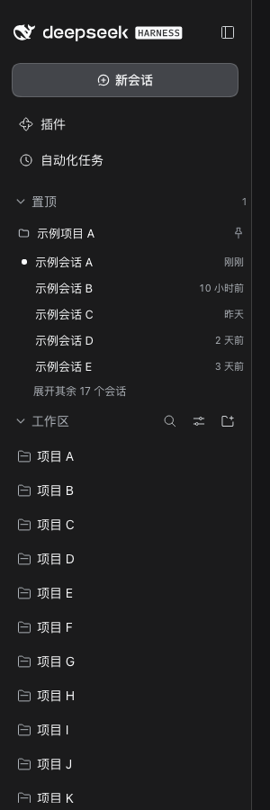
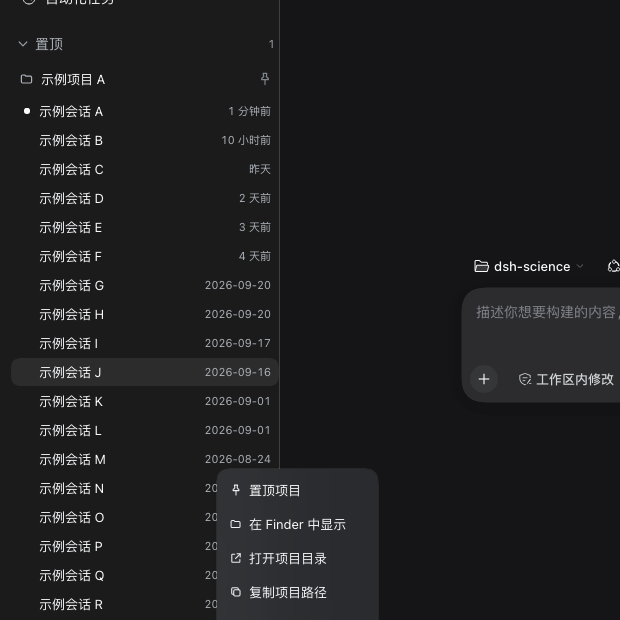
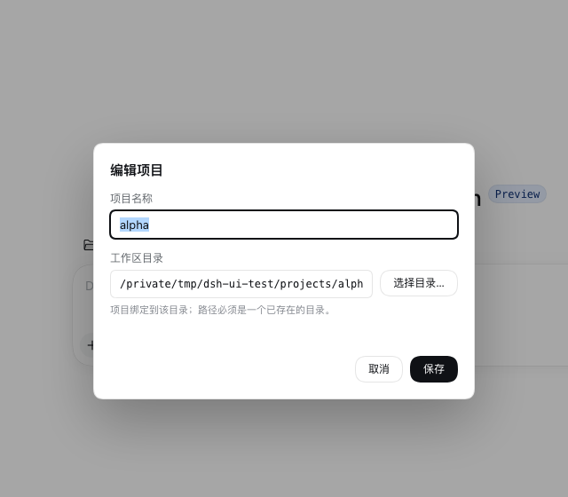

# Codex 式侧栏增强（Sidebar Enhancement）

> 一句话：**Codex 式侧栏增强**把 DSH 左侧栏改造成 Codex 的三段式结构 ——
> **置顶（Pinned）→ 工作区（Projects）→ 最近（Recents）**：置顶与「工作区」平行、显示在
> 其上方；置顶/工作区行支持置顶、**编辑项目（改名 / 更换绑定目录）**、定位目录、开新会话等
> **项目级操作**（并入原生「…」菜单与右键菜单），「最近」聚合并按时间倒序展示最新的会话；
> 悬停只展示项目状态。
> 实现分两半 —— 客户端 DOM 增强（`client/remote-hosts-ui/src/sidebar.js`）+
> 宿主 REST 引擎（`engines/sidebar-ui.mjs`），置顶状态跨重启持久化。

## 界面预览







## 界面功能

| 区块 | 功能 |
| --- | --- |
| 置顶（Pinned）区 | 与原生「工作区」**平行**、显示在其上方的独立 section（不是工作区列表内部的一组）：标题可整体收起（状态记在 `localStorage`）；每个置顶项目行带 caret，**点击行/ caret 可内联展开该项目自己的会话列表**（与 Codex 的 pinned project 一致，按最近活跃倒序、显示相对时间与运行中圆点，点击会话直接打开），**默认只显示前 5 条会话**，底部显示「展开其余 N 个会话」（每次 +5，剩余 ≤5 时一次展开全部；全部展开后显示「收起会话」）——与原生工作区分组的水位行为一致；展开状态记 `localStorage`；悬停时行尾出现「…」与「新建会话」按钮（与原生工作区行一致）；悬停显示项目状态卡；右键或「…」菜单可取消置顶/定位目录（右键的「展开 / 收起会话」对置顶行切换内联展开）。无置顶时显示空态提示「右键工作区 → 置顶项目」。 |
| 工作区（Projects）区 | 原生工作区浏览区（搜索 / 筛选 / 添加工作区 / 分组）原样保留；在 sectionHeader 左侧注入与置顶/最近一致的 caret，点击 caret **或标题**都能整体折叠（状态记 `localStorage`）：折叠时隐藏会话列表与搜索/添加图标，「最近」随之上移。 |
| 整体滚动 | 置顶 / 工作区 / 最近不再各自限高、各自滚动，而是共用侧栏中段（`regionArea`）这一个纵向滚动容器：活动区从「置顶」一路连续滚到「最近」，不会出现置顶展开后把工作区/最近挤没的情况。品牌行、新会话、全局面板行、侧栏 footer 固定不滚动；侧栏收起为 rail 或进入搜索视图时自动还原原生的列表内部滚动。 |
| 最近（Recents）区 | 与「工作区」平行、位于其下方的独立 section：跨工作区聚合并按 `updatedAt` 倒序展示最近会话（排除空白草稿、子代理会话、已归档会话），最多 20 条（随整个中段一起滚动）；每行显示会话标题、运行中圆点、相对时间，点击经 `uiWorkspace.openSession` 直接打开该会话（服务不可用时退回点击原生会话行，必要时先展开所属工作区）。标题可整体收起。 |
| 编辑项目 | 原生工作区行悬停时出现铅笔按钮，置顶项目行悬停时同样出现编辑按钮；原生「…」菜单与右键菜单也提供「编辑项目…」。对话框可改**项目名称**与**工作区目录**（目录可用「选择目录…」调系统原生的目录选择器，也可手动输入；必须是已存在的目录）。保存后置顶状态、展开状态与工作区顺序都会跟着迁移；若目标目录已被别的项目占用则拒绝并提示。 |
| 工作区行「…」菜单 | 原生「…」菜单顶部插入项目级动作：置顶 / 取消置顶项目 · 编辑项目… · 在 Finder（macOS）/ 资源管理器（Windows）/ 文件管理器中显示 · 打开项目目录 · 复制项目路径 · 在新会话中打开项目 · 展开 / 收起会话；分隔线之后保留原生的重命名/删除。插入项复用原生菜单项的样式与键盘导航（↑/↓、Enter、Esc），动作执行后自动关闭菜单。 |
| 工作区行右键菜单 | 同样的项目级动作也可在工作区行上右键直接打开（置顶/取消置顶、编辑项目、在 Finder 中显示、打开项目目录、复制项目路径、在新会话中打开、展开/收起会话）；菜单自动避让视口边缘，支持 ↑/↓ 与 Esc。 |
| 悬停信息 | 悬停只展示项目状态，不放操作按钮：原生工作区悬停卡（标题/路径/创建时间）追加会话数、运行中数、最近活跃、已置顶标记；置顶区行使用独立的项目状态卡。数据来自 `ctx.get("workspaces")` / `ctx.get("sessions")` 的实时快照。 |
| 已置顶标记 | 已置顶的工作区行右侧显示置顶图标（鼠标悬停时让位给原生行操作）。 |
| 视觉统一 | 置顶项目行与原生「工作区」项目行保持一致：文件夹图标、34px 行高、`0 8px` 内边距、名称缩进一致（实测两者名称 x 相同）；悬停时文件夹让位给 caret、右侧出现「…」与「新建会话」，与原生 hover 行为一致。置顶项目的会话行也与原生会话行一致：无额外气泡图标、28px 行高、标题缩进一致、运行中在左侧状态位显示圆点、右侧相对时间。
| 标题排版 | 置顶 / 工作区 / 最近三个 section 的标题共用同一套排版（14px / 常规字重 / tertiary 色 / 36px 行高、左侧 caret + 4px 间距），注入的 caret 与标题左对齐，与原生「工作区」标题在同一 x 位置，避免三段标题大小/缩进不一致。 |

## 架构

```
浏览器（DSH Web / 桌面壳）                        DSH 宿主（Node）
┌────────────────────────────────┐              ┌───────────────────────────────────┐
│ 左侧栏 DOM（ui-workspace 原生）│  POST JSON   │ engines/sidebar-ui.mjs            │
│  ├ 置顶（Pinned，DOM 注入）    │ ───────────► │ webServer 前缀路由                 │
│  ├ 工作区（原生 Workspaces）   │ /dsh-science │   /dsh-science/sidebar/*          │
│  ├ 最近（Recents，DOM 注入）   │  /sidebar/*  │ config/pins/pin/unpin/reveal/open │
│  └ 工作区行「…」菜单 + 悬停状态 │              │                                   │
│ client/remote-hosts-ui/        │ ◄─────────── │                                   │
│   src/sidebar.js               │  {ok,...}    └───────────────┬───────────────────┘
│   └ MutationObserver 恢复注入  │                              │ node:fs / child_process
└────────────────────────────────┘                              ▼
                          $DSH_HOME/dsh-science/sidebar.json（置顶，schema 1）
                          open -R / explorer /select, / xdg-open（系统文件管理器）
```

- **宿主侧**（`engines/sidebar-ui.mjs`，零第三方依赖）：name `science-sidebar-ui`，
  `inject: ["webServer"]`，作为 bundle 行挂载（`cordis.patch.yml` 的 `science-sidebar-ui`，
  **不进 preset/engines 镜像**）。注册前缀路由 `/dsh-science/sidebar`，提供 `config / pins /
  pin / unpin / reveal / open` 六个 JSON 方法；业务与校验错误统一 `HTTP 200 + {ok:false,error}`，
  客户端只看 `ok` 字段。
- **客户端**（`client/remote-hosts-ui/src/sidebar.js`）：由 `scripts/build-client-bundle.mjs` 按
  `sidebar.js → workbench.js → roadmap.js → index.js` 的顺序拼接进 `lib/client.js`，主入口
  `index.js` 的 `apply` 调用 `applySidebar(ctx)`。置顶状态只经宿主路由落盘；DOM 增强本身只写
  `localStorage`（置顶区收起状态），不改项目文件。原生「…」菜单的动作是「监听工作区行的
  actions 按钮点击 → 等 portal 菜单出现 → 克隆一个原生菜单项、改写文案/图标后插到菜单顶部」，
  这样视觉与键盘导航（↑/↓、Enter、Esc）都复用 shell 的菜单实现，动作完成后向菜单发 Esc
  关闭它。
- **数据**：工作区/会话先读平台 client 服务快照（与原生列表同一份数据），DOM 只负责锚点定位与
  渲染；置顶文件与系统文件管理器操作都在宿主侧完成。三个 section 的排布：置顶插在侧栏
  `regionArea`（承载原生「工作区」浏览区）内部、浏览器 wrapper 的前后，并把
  `regionArea` 设为整段滚动容器（同时取消原生 `.list` 与本节 section 的内部限高滚动），
  因此视觉顺序与 Codex 的 Pinned / Projects / Recents 一致且连续滚动；收起为 56px rail
  或进入搜索视图时移除滚动标记、隐藏两个注入 section，恢复原生滚动行为。

## 为什么用 DOM 注入

DSH shell 的左侧栏工作区/会话浏览区由 `sidebar.workspaces` **single slot** 提供，原生
`ui-workspace` 已占用该 slot，插件无法再注册第二个 occupant；`settings.section` /
`conversation.view` 等 slot 也不覆盖侧栏行级交互。因此增强走 DOM 层：

- 锚在**语义属性**而非 CSS Module 哈希类名：`[data-row-key^="workspace:"]` 行、侧栏浏览区根节点
  （向上找到含 `class*="_sectionHeader"` 子节点的祖先）下 `class*="_listArea"` 的列表容器
  （置顶区插到它前面）、原生悬停卡
  `body > div[role="button"][aria-label^="Copy: "]` 内的 `class*="_hoverContent"`。
- `MutationObserver` 监听相关 DOM 变更（只关心侧栏行 / `_listArea` / `_sectionHeader`，忽略
  会话消息流式渲染），React 重渲染把注入节点移走或覆盖后自动重新安放；置顶区内容按签名去重，
  避免自身变更触发观察循环。
- 增强节点使用 `dshsci-*` 类名并带 `data-plugin` / `data-plugin-css` 标记，插件卸载时随
  client-modules 一起清理，不修改 shell 本身。

## 数据与安全

| 项 | 说明 |
| --- | --- |
| 置顶键 | 以 `workspaceId` 为唯一键；`path` / `title` 只是展示副本，工作区改名或移动后以平台快照为准；工作区已注销的悬空置顶不展示。 |
| 存储 | `$DSH_HOME/dsh-science/sidebar.json`，`{schema:1,pins:[{workspaceId,path,title,pinnedAt}]}`，最近置顶在前，最多 100 条；`DSH_HOME` 缺省 `~/.dsh`（与工作台/远程主机同一约定）。 |
| 写入 | 进程内 promise 互斥串行化 read-modify-write + 临时文件 `rename` 原子写；文件损坏时先重命名为 `sidebar.json.corrupt-<时间戳>.json` 再重建（不删用户数据）。 |
| 路径校验 | `reveal` / `open` 只接受**绝对路径**，且必须存在、是目录；路径长度上限 4096。宿主不写项目文件、不执行项目内代码，只把目录交给系统文件管理器。 |
| 来源校验 | 复用 `engines/http-guard.mjs`：有 `Origin` 时必须与 `Host` 同 authority；桌面端 `dsh-app://app` 经主进程转发（无 Origin + 回环 Host）放行；`Sec-Fetch-Site: cross-site` 一律拒绝。 |
| 方法限制 | **POST-only**（非 POST → 405），未知方法 → 404，body 上限 1MB；跨站来源 → 403。 |
| 审批 | 侧栏操作都是**用户本人手动触发**，不弹审批（用户即授权者）；Agent 经工具触发的远程/文件操作仍走原有审批，两套互不冲突。 |
| 参数校验 | `workspaceId` 非空且 ≤ 200 字符、`title` 必须是字符串且 ≤ 200、未知字段直接报错。 |

## 安装 / 更新

client 插件是 **profile/bundle 级**功能（不进 agent preset）：

```bash
node scripts/build-client-bundle.mjs    # 修改 src/sidebar.js 后重新生成 lib/client.js
node scripts/build-client-bundle.mjs --check   # 校验 bundle 与源码哈希一致（CI 门禁）
dsh plugin --profile web add "github:biociao/dsh-science"   # 或已有 symlink 安装则跳过
# 重启 dsh web / 桌面 profile，再刷新页面
```

> 改完 bundle 后**必须重启宿主进程**再刷新页面：仅刷新页面只会重载 client bundle，不会加载
> 新的 `cordis.patch.yml` 行；宿主路由缺失时侧栏会降级为「无置顶持久化」。
> `cordis.patch.yml` 的 `science-sidebar-ui` 仅 bundle 形态挂载，不进 `preset/engines/` 镜像。

## 测试

| 命令 | 覆盖 |
| --- | --- |
| `node test/sidebar-ui.test.mjs` | 宿主侧 65 项：模块契约、空/损坏存储、pin/unpin/排序/上限/重载、参数校验、darwin/linux/win32 的 reveal/open 命令（注入 fake spawn）、405/403/404 与 body 上限。 |
| `node test/sidebar-client.test.mjs` | 客户端 35 项：bundle 形状与加载、纯函数（转义/相对时间/平台文案/菜单模型/菜单夹取/会话统计/置顶规范化）、无 DOM 时静默跳过、bundle 含锚点与宿主路由的静态护栏。 |
| `node scripts/smoke-test.mjs` | 第 13 节：补丁行、引擎契约、置顶路由读写、平台命令与错误码。 |
| `node scripts/build-client-bundle.mjs --check` | bundle 与源码哈希一致。 |

测试全部 headless、零依赖，只在 `mkdtemp` 临时目录与注入的 fake spawn 上运行，不碰真实
`~/.dsh`、不真的打开文件管理器。

## 常见问题

- **置顶区不显示**：正常情况下即使没有置顶项也会显示「置顶」section（带空态提示）；若整个
  section 都没有，说明侧栏还停在旧 bundle（重启 DSH / 刷新页面）或侧栏处于 56px rail 收起态。
  置顶动作需要至少一个已渲染的工作区行来定位原生列表，工作区列表为空时请先添加工作区。
- **点一次「置顶项目」看起来没生效、项目又跳回工作区，第二次才成功？** 这是启动时 `pins`
  读取较慢造成的竞态（旧快照在置顶写入之后返回，覆盖了本地置顶状态）。现已用 revision 守卫：
  pin/unpin 写入会让所有更早发起的 `pins` 读取失效，并优先采用宿主写入响应里的权威列表；
  同时启动读取、编辑项目后的刷新都走同一守卫。若仍遇到，刷新页面即可（宿主会自动加载最新 bundle）。
- **编辑项目里改了「工作区目录」会发生什么？** DSH 的工作区注册记录本身不支持原地改路径，
  所以「更换目录」的语义是：把新目录注册成一个工作区，再移除旧工作区注册。旧工作区的会话记录
  不会删除，但会落到原生「未分组」里；置顶状态、展开状态和工作区顺序会迁移到新注册上，项目名称
  保持不变（对话框里会明确提示）。如果新目录已经绑定了别的项目，会直接拒绝并提示，不会改动任何
  项目。仅改名称则直接调用原生 rename，不动目录与会话。
- **置顶展开很多会话后工作区/最近看不到 / 下方项目点不到**：整个中段（置顶 → 工作区 → 最近）
  是一个滚动容器，直接上下滚动侧栏即可；品牌行、新会话、插件行与 footer 固定不动。
  该滚动容器的 `overflow` 用 `!important` 固定为 `auto`（原生 `regionArea` 的
  `overflow:hidden` 同权重且加载更晚，不加会被覆盖成裁切/不可滚动）；若仍不能滚动，
  确认已刷新页面/重启宿主拿到最新 bundle。
- **最近（Recents）为空**：会话列表里只有空白草稿、子代理会话或已归档会话时该 section 不显示；
  若主会话列表尚未拉取完成（刚启动），稍等会自动出现。点击最近会话走 `uiWorkspace.openSession`，
  不依赖原生行是否渲染。
- **「…」菜单里没有项目操作**：动作是在原生菜单 portal 出现后插入的；若宿主未安装/未重启，
  菜单仍只有原生重命名/删除。另外 macOS「在 Finder 中显示」文案随宿主 `config` 返回的 `platform` 变化（macOS
  「在 Finder 中显示」/ Windows「在资源管理器中显示」/ 其他「在文件管理器中显示」）；宿主
  不可用时显示通用文案。Linux 的 `xdg-open` 没有「选中文件」语义，`reveal` 实际打开的是**父目录**。
- **宿主未安装时怎么降级**：客户端 `config` / `pins` 请求失败会被静默吞掉 —— 置顶区保持隐藏
  （空列表），右键菜单仍可纯客户端完成复制路径 / 开新会话 / 展开收起；置顶、在文件管理器中显示、
  打开目录会失败并弹 toast，但不会抛未捕获异常、不阻塞原生侧栏。
- **DSH 升级后锚点变化**：增强依赖 `data-row-key^="workspace:"`、`_listArea`、原生悬停卡的
  `aria-label^="Copy: "` + `_hoverContent` 等语义锚点。验证环境为 DSH 0.2.1-rc.2
  （ui-workspace 0.2.1）；若升级后某类锚点消失，对应功能会静默失效或只保留一部分（例如置顶区
  还在、悬停卡不再追加信息），但**页面不会崩**。排查：浏览器控制台看
  `/dsh-science/sidebar/config` 是否返回 200，Elements 面板搜 `dshsci-` 类名；必要时按新 DOM
  调整 `sidebar.js` 顶部的选择器常量并重新构建 bundle。
